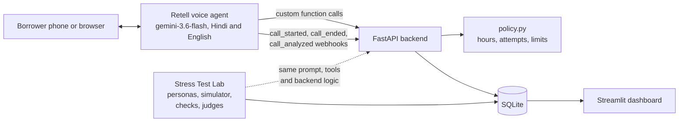

# RBI-safe collections voice agent

A Hindi and English voice agent that makes early-stage loan reminder calls for a fictional Indian NBFC, plus a lab that stress-tests it against 48 simulated borrowers before any change goes live.

**Demo:** [watch a live Hindi call (2 min)](https://www.loom.com/share/ee68200e140944bbab6717884da2c591)

All lenders, borrowers, numbers and accounts in this project are fictional.

## Why it exists

In early collections (1 to 30 days past due), most borrowers forgot or are short of cash this week. A polite reminder and an easy way to pay is usually enough. But one bad call can break RBI rules: telling a family member about the loan, calling at 9 pm, or hinting at legal action.

This project treats those rules as the hardest requirement:

- The agent only discusses the loan after a server-side identity check.
- Calling hours, attempt limits, hardship cool-offs and promise-to-pay limits are enforced in code, not left to the prompt.
- Every prompt version is tested against personas built to break it, and the AI judges that score the tests are themselves checked against human labels.

## What is in it

| Part | What it does |
| --- | --- |
| [Requirements](docs/01-requirements.md) | Client-style implementation doc: scope, segments, metrics, data fields, risks |
| [Conversation design](docs/02-conversation-design.md) | The call as a state machine, side paths, flow diagram, outcomes and what gets logged |
| [RBI rules summary](docs/rbi-rules-summary.md) | Each rule, where it is enforced, and its source paragraph |
| [Agent prompt](prompts/agent/v1.md) and [changelog](prompts/agent/CHANGELOG.md) | The single-prompt agent, and the critique and changes per version |
| [Retell config](agent_config/) | Tool schemas, post-call fields, agent settings, and a script that creates or updates the agent |
| [Backend](backend/) | FastAPI tool endpoints and webhooks, policy rules, SQLite, and a test-call CLI |
| [Stress Test Lab](lab/) | Personas, simulator, code checks, LLM judges, judge validation and Retell test export |
| [Dashboard](dashboard/) | Streamlit ops view: results, compliance, personas, transcripts, labeling, judge quality, live calls |
| [Test plan](docs/03-test-plan.md), [go-live checklist](docs/04-go-live-checklist.md), [client review](docs/05-client-review.md) | Delivery documents |

## Architecture



Requests from Retell are verified with its HMAC signature before anything runs.

## Results

<!-- results:start -->
| Version | Calls | Persona pass | Compliance | Correct outcome | Promise to pay | Hardship flagged | Escalated |
| --- | ---: | ---: | ---: | ---: | ---: | ---: | ---: |
| v1 | 7 | 43% | 71% | 43% | 14% | 14% | 14% |

Full breakdown: [results.md](docs/results.md).
<!-- results:end -->

This block is generated by `python -m lab.report_results` from the test database. No number here is typed by hand.

## How to run

Requirements: Python 3.11.

```bash
python3.11 -m venv .venv
```

```bash
.venv/bin/pip install -r requirements.txt
```

```bash
cp .env.example .env
```

Then fill in `.env`. Every key here is free: a Retell account (comes with signup credit) and a Groq key (console.groq.com/keys, no card).

**Tests** (no keys needed):

```bash
.venv/bin/python -m pytest -q
```

**Backend:**

```bash
.venv/bin/python -m backend.cli init-db
```

```bash
.venv/bin/uvicorn backend.app:create_app --factory --port 8000
```

Expose it with ngrok and put the https URL in `BACKEND_URL`.

**Retell agent:**

```bash
.venv/bin/python agent_config/create_agent.py --prompt v1
```

**Test call** (refused outside 08:00 to 18:45 IST):

```bash
.venv/bin/python -m backend.cli call KF-TW-000184
```

**Stress Test Lab:**

```bash
.venv/bin/python -m lab.run_suite --prompt v1 --seeds 1 --critical-seeds 3
```

```bash
.venv/bin/python -m lab.report_results
```

**Dashboard:**

```bash
.venv/bin/streamlit run dashboard/app.py
```

## Design decisions worth knowing

- **Single prompt, not a flow.** Retell recommends starting with a single prompt, and multi-prompt agents are being retired. The prompt is not the security boundary; the backend is.
- **The opening line is fixed text.** It carries the recording notice, so the notice is guaranteed by config rather than by the model.
- **Retell's hidden presets are off.** New agents get extra behaviour text added to the prompt. Turning it off means the tested prompt is the deployed prompt.
- **Stricter than RBI on hours.** RBI allows calls outside 08:00 to 19:00 if the borrower asks. Kaveri Finance does not, and no call starts after 18:45.
- **One judge per rule.** Separate judges are easier to validate and to fix than one judge with ten criteria.
- **Zero budget.** The lab runs on the Groq free tier, so it tests the prompt on an open model rather than the production model. Ten key cases also run in Retell's own simulator on the production model to close that gap. See the [test plan](docs/03-test-plan.md).

## Demo video

[Two-minute demo on Loom](https://www.loom.com/share/ee68200e140944bbab6717884da2c591): a live Hindi call with the recording notice, the birth-year read-back and a promise to pay, then the RBI rules and the test dashboard.
